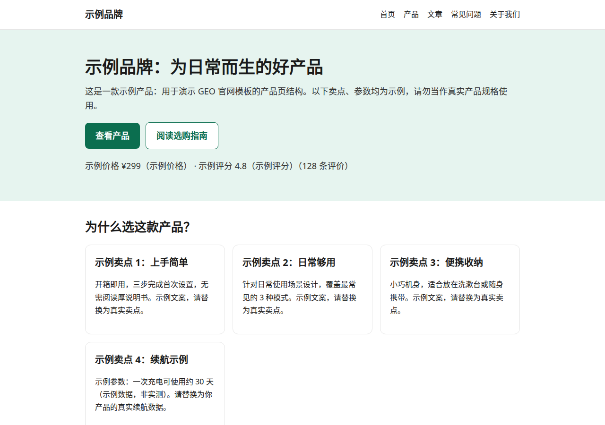
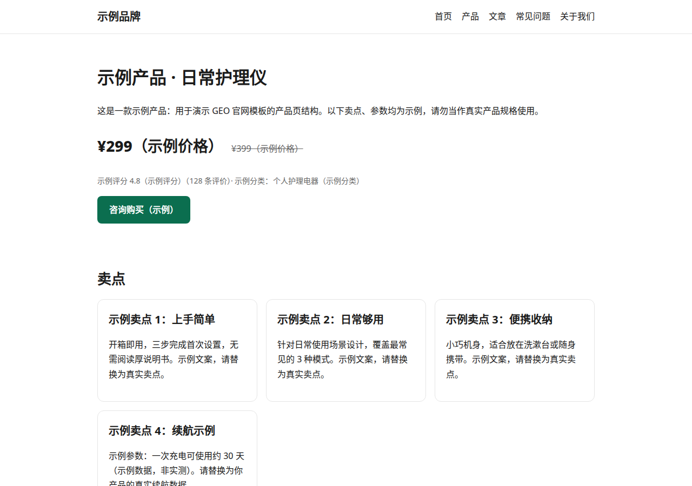

# GEO Website Template

> A forkable brand website template optimised for AI search (GEO). Edit one config file and deploy. No paid API, no backend, no database.

[Read this in Chinese （中文版）](README.md)


**Fork this repo first (top right), then follow the 3 steps below to rebrand and deploy. Forking is how you use it.**

[](https://vercel.com/new/clone?repository-url=https://github.com/Garyxie-ing/geo-website-template) [](https://app.netlify.com/start/deploy?repository=https://github.com/Garyxie-ing/geo-website-template)

## What is this

A website template for brands, indie developers, and small businesses. Fork it, edit `config/site.json`, and your brand name, product, selling points, price, FAQ, and contact details will appear across the whole site.

Built-in GEO optimisation:

- Semantic HTML (`header` / `main` / `article` / `section`), responsive on mobile
- SEO meta + Open Graph on every page
- Structured data (JSON-LD): Organization on the home page, Product on the product page, FAQPage on the FAQ page, Article on article pages
- `/llms.txt` (a site summary for AI crawlers), `/sitemap.xml`, and `/robots.txt` — all three generated automatically from `config/site.json`
- Long-form article structure: conclusion first, then section headings, then an FAQ at the end, so AI can quote it easily

## Quick start (3 steps)

```bash
git clone https://github.com/<your-username>/geo-website-template.git
cd geo-website-template
npm install
npm run dev
```

Open http://localhost:3000 to preview.

Build the static site:

```bash
npm run build
# Generates the out/ folder — upload it to any static host
```

## Rebrand in 5 minutes

Edit just one file: `config/site.json`

| Change this | Changes across the site |
|---|---|
| `site.url` | sitemap, llms.txt, canonical, OG links |
| `brand.name` / `brand.tagline` / `brand.description` | header, footer, home title, SEO description |
| `product.*` | product page name, price, selling points, spec table, how-to |
| `faqs` | FAQ page + home excerpt + JSON-LD |
| `site.email` / `site.phone` / `site.address` | footer, about page, Organization structured data |

After editing, run `npm run build` again — `public/sitemap.xml`, `public/robots.txt`, and `public/llms.txt` regenerate automatically. No page code needs changing.

To add an article: open `lib/articles.ts` and add one entry following the format of the two example articles. Routes and the sitemap are handled automatically (add one line for the article page in the `pages` list in `scripts/generate-seo.mjs`).

## Deploy

### Vercel (one click)

1. Fork this repo
2. In Vercel, click New Project and select this repo
3. Deploy directly (static export is already configured — no build-command changes needed)

### Static hosts (Netlify / GitHub Pages / InfinityFree, etc.)

```bash
npm run build
```

Upload everything inside the generated `out/` folder to the host's root directory. `out/` already contains `index.html`, `sitemap.xml`, `robots.txt`, and `llms.txt`.

## Pages

| Route | Content |
|---|---|
| `/` | Home: Hero, selling points, latest articles, FAQ excerpt |
| `/product/` | Product page: price, selling points, spec table, how-to + Product JSON-LD |
| `/articles/` | Article list |
| `/articles/how-to-choose/` | Example long-form article 1: buying guide |
| `/articles/how-to-use-daily/` | Example long-form article 2: daily use and common mistakes |
| `/faq/` | FAQ + FAQPage JSON-LD |
| `/about/` | About us + contact details |
| `/llms.txt` | AI crawler summary |
| `/sitemap.xml` | Sitemap |
| `/robots.txt` | Crawler rules (GPTBot / ClaudeBot / PerplexityBot already allowed) |

## GEO checklist

Tick these off after deploying:

- [ ] `site.url` in `config/site.json` is your real domain
- [ ] Brand name, product name, price, and FAQ are all replaced with real content (example text fully removed)
- [ ] Sitemap submitted in Google Search Console / Bing Webmaster
- [ ] Opening `/llms.txt` shows your brand information
- [ ] Product / FAQPage / Article are recognised by the [Google Rich Results Test](https://search.google.com/test/rich-results)
- [ ] Every article gives the conclusion first, then sections, then an FAQ

## Screenshots

> Screenshots are locally rendered example-brand pages.





## Tech stack

- Next.js 14 App Router + TypeScript (static export, no server)
- Plain CSS, no CSS framework dependency — fast builds, fast loading
- No backend, no database, no paid API, no API key needed

## Contributing

Issues and PRs are welcome — see [CONTRIBUTING.md](CONTRIBUTING.md).

## License

MIT — see [LICENSE](LICENSE).
