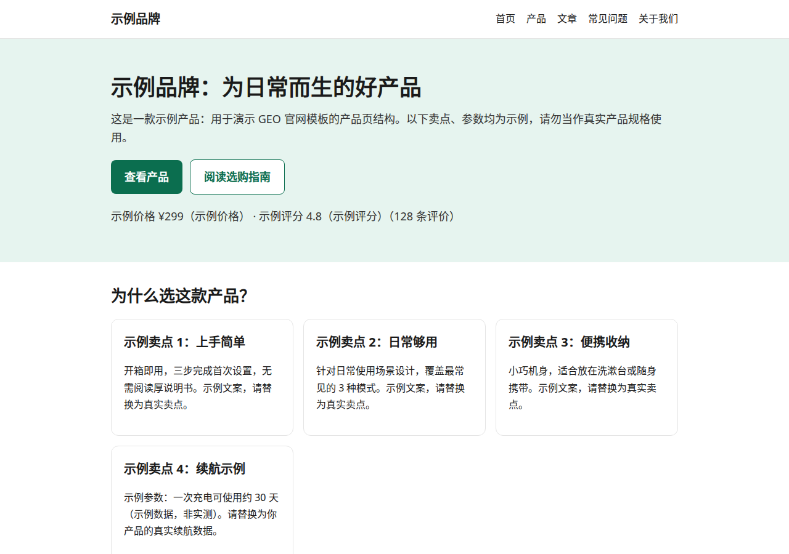
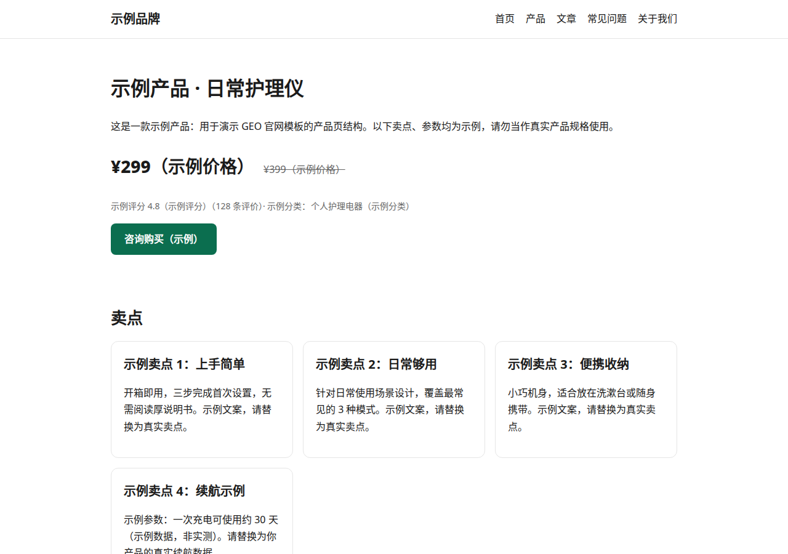
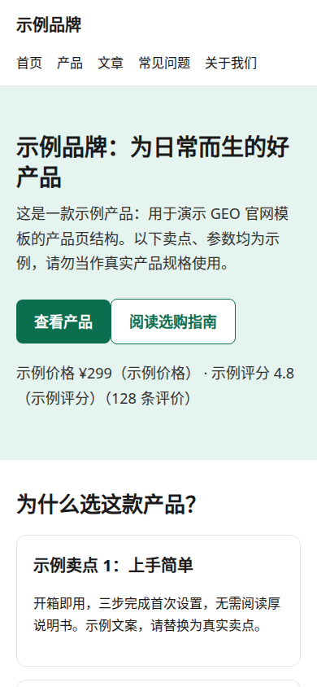

# GEO 官网模板

[English](README.en.md)

> 一个 Fork 就能用的品牌官网模板，为 AI 搜索（GEO）优化：改一个配置文件，部署即上线。
> A forkable brand website template optimised for AI search (GEO). Edit one config file and deploy. No paid API, no backend, no database.


**想用就先点右上角 Fork，再按下面 3 步改配置、部署上线。Fork 就是使用方式。**

[](https://vercel.com/new/clone?repository-url=https://github.com/Garyxie-ing/geo-website-template) [](https://app.netlify.com/start/deploy?repository=https://github.com/Garyxie-ing/geo-website-template)

## 这是什么

给品牌、独立开发者、小商家用的官网模板。Fork 回去，改 `config/site.json`，你的品牌名、产品、卖点、价格、FAQ、联系方式就会出现在全站。

内置的 GEO 优化：

- 语义化 HTML（`header` / `main` / `article` / `section`），移动端自适应
- 每个页面都有 SEO meta + Open Graph
- 结构化数据 JSON-LD：首页 Organization、产品页 Product、FAQ 页 FAQPage、文章页 Article
- `/llms.txt`（给 AI 爬虫读的网站摘要）、`/sitemap.xml`、`/robots.txt`，三者都由 `config/site.json` 自动生成
- 长文结构：先给结论，再分段小标题，最后附 FAQ，方便 AI 引用

## 快速开始（3 步）

```bash
git clone https://github.com/<你的用户名>/geo-website-template.git
cd geo-website-template
npm install
npm run dev
```

打开 http://localhost:3000 即可预览。

构建静态站：

```bash
npm run build
# 生成 out/ 文件夹，直接上传到任何静态主机即可
```

## 5 分钟换成你的品牌

只改一个文件：`config/site.json`

| 改这里 | 全站会变 |
|---|---|
| `site.url` | sitemap、llms.txt、canonical、OG 链接 |
| `brand.name` / `brand.tagline` / `brand.description` | 页眉、页脚、首页标题、SEO 描述 |
| `product.*` | 产品页名称、价格、卖点、参数表、使用方法 |
| `faqs` | FAQ 页 + 首页节选 + JSON-LD |
| `site.email` / `site.phone` / `site.address` | 页脚、关于页、Organization 结构化数据 |

改完重新跑 `npm run build`，`public/sitemap.xml`、`public/robots.txt`、`public/llms.txt` 会自动重新生成。不用改任何页面代码。

要加文章：打开 `lib/articles.ts`，按现有两篇示例的格式加一条即可，路由和 sitemap 会自动处理（文章页需在 `scripts/generate-seo.mjs` 的 `pages` 里补一行）。

## 部署

### Vercel（一键）

1. Fork 本仓库
2. 在 Vercel 点 New Project，选这个仓库
3. 直接 Deploy（已配置静态导出，无需改构建命令）

### 静态主机（Netlify / GitHub Pages / InfinityFree 等）

```bash
npm run build
```

把生成的 `out/` 文件夹里的全部内容上传到主机根目录即可。`out/` 里已包含 `index.html`、`sitemap.xml`、`robots.txt`、`llms.txt`。

## 页面清单

| 路由 | 内容 |
|---|---|
| `/` | 首页：Hero、卖点、最新文章、FAQ 节选 |
| `/product/` | 产品页：价格、卖点、参数表、使用方法 + Product JSON-LD |
| `/articles/` | 文章列表 |
| `/articles/how-to-choose/` | 示例长文 1：选购指南 |
| `/articles/how-to-use-daily/` | 示例长文 2：使用方法与误区 |
| `/faq/` | 常见问题 + FAQPage JSON-LD |
| `/about/` | 关于我们 + 联系方式 |
| `/llms.txt` | AI 爬虫摘要 |
| `/sitemap.xml` | 网站地图 |
| `/robots.txt` | 爬虫规则（已允许 GPTBot / ClaudeBot / PerplexityBot） |

## GEO 检查清单

部署后逐项打勾：

- [ ] `config/site.json` 里的 `site.url` 已改成你的真实域名
- [ ] 品牌名、产品名、价格、FAQ 已全部替换为真实内容（示例文字已删干净）
- [ ] 在 Google Search Console / Bing Webmaster 提交 sitemap
- [ ] 打开 `/llms.txt` 能看到你的品牌信息
- [ ] 用 [Google 富媒体搜索结果测试](https://search.google.com/test/rich-results) 检查 Product / FAQPage / Article 是否被识别
- [ ] 每篇文章都先给结论、再分段、最后附 FAQ

## 截图

> 截图为本地渲染的示例品牌界面。





## 技术栈

- Next.js 14 App Router + TypeScript（静态导出，无服务端）
- 纯 CSS，无 CSS 框架依赖，构建快、加载快
- 无后端、无数据库、无付费 API、无需 API Key

## 贡献

欢迎提 Issue 和 PR，见 [CONTRIBUTING.md](CONTRIBUTING.md)。

## 许可证

MIT，见 [LICENSE](LICENSE)。
